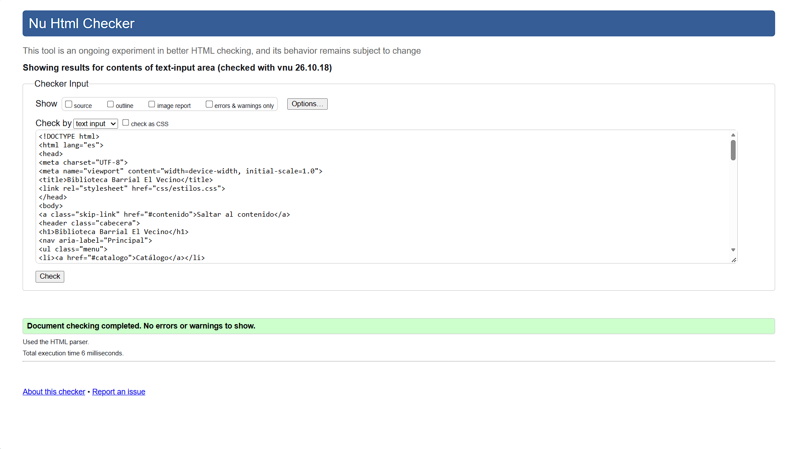
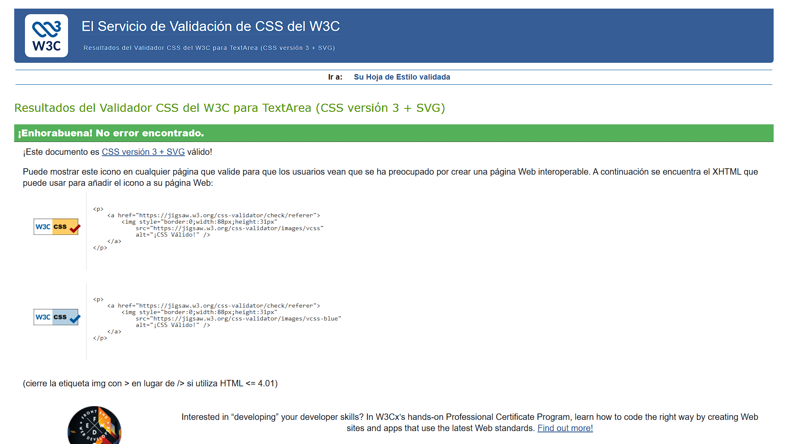

## Auditoria a compañero Andres Yadancela

## Realizada por: Juan José Abril L.

# Informe de auditoria

| N.º | Requisito | ¿Qué espero encontrar? | Ubicación (archivo y línea o selector) | Hallazgo | Norma que incumple | Evidencia | Severidad (alta, media, baja) |
| :---: | :--- | :--- | :--- | :--- | :--- | :---: | :---: |
| **1** | Base 1: Estructura semántica completa | Espero encontrar en el código es una maqueta de HTML5 bien organizada y usando las etiquetas semánticas correctas: header, nav, main, aside y footer. Dentro del área principal (main), debe haber al menos dos bloques de contenido usando section o article, y cada uno debe tener su propio título. | index.html | El código cumple con el requisito | Ninguna | -- | -- |
| **2** | Base 2: Formulario | En esta parte espero encontrar un formulario de al menos 5 campos con sus etiquetas `<label>` bien vinculadas (`for`/`id`), tipos de `input` adecuados, validaciones nativas (`required`, `pattern`) y todo agrupado dentro de un `<fieldset>` con su `<legend>`. Que al hacer clic en el texto del `<label>`, el cursor se ponga automáticamente dentro de su casilla | index.html Línea (46-73)  | El código cumple con el requisito | Ninguna | -- | -- |
| **3** | Base 3: Tabla de datos | Espero que la tabla se use solo para mostrar información cuantitativa o comparativa, y que un usuario con discapacidad visual pueda saber a qué columna pertenece cada dato | index.html Línea (27-34)  | El código cumple con el requisito | Ninguna | -- | -- |
| **4** | Base 4: Layout responsive con Grid y Flexbox | Que al encoger la pantalla del navegador no aparezca la barra de desplazamiento horizontal en la parte inferior, y que los bloques de contenido se reacomoden verticalmente de forma fluida. | css/estilos.css  | El código cumple con el requisito | Ninguna | -- | -- |
| **5** | Base 5: Colores definidos como variables | Espero encontrar los colores definidos con variables CSS (como `--color-...`) en `:root` y un contraste mínimo de 4.5:1 entre texto y fondo para garantizar una lectura cómoda y sin esfuerzo.| css/estilos.css Línea (1-6)  | El código cumple con el requisito | Ninguna | -- | -- |
| **6** | Base 6: Navegación completa | Espero poder recorrer la página usando únicamente la tecla `Tab` para acceder a cada enlace, botón o casilla, comprobando que siempre se vea un borde o resplandor claro en el elemento seleccionado para no perder la ubicación al navegar sin ratón. | css/estilos.css Línea (5 y 11)  | El código cumple con el requisito | Ninguna | -- | -- |
| **7** | Base 7: Validación HTML y CSS | Espero que al pasar los archivos por los validadores oficiales del W3C (HTML y CSS) el resultado no marque ningún error de sintaxis, etiquetas mal cerradas o atributos obsoletos. | index.html - css/estilos.css  | El código cumple con el requisito | Ninguna |   | -- |
| **8** | Base 8: Imagenes con alt adecuado | Espero que cada etiqueta `` tenga su atributo `alt` con una descripción breve de lo que muestra la imagen, permitiendo que un lector de pantalla se la explique a un usuario que no pueda verla. | index.html Línea 24 | El código cumple con el requisito | Ninguna | -- | -- |
| **9** | Específico 1: Carga de archivos con tipo restringido | index.html Linea 68  | El código cumple con el requisito | Ninguna | -- | -- |
| **10** | Específico 2: Breakpoint principal | css/estilos.css Linea 17  | El código cumple con el requisito | Ninguna | -- | -- |
| **10** | Específico 3: Hoja de estilos para impresión | css/estilos.css Linea (39-44)  | El código cumple con el requisito | Ninguna | -- | -- |
