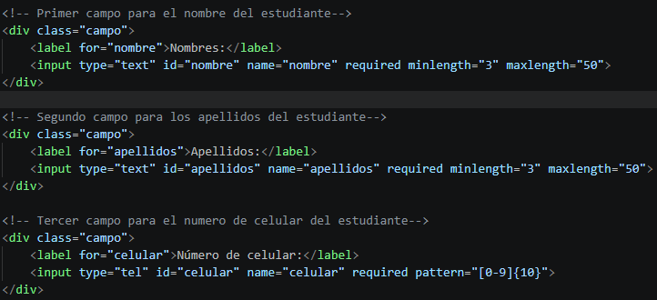
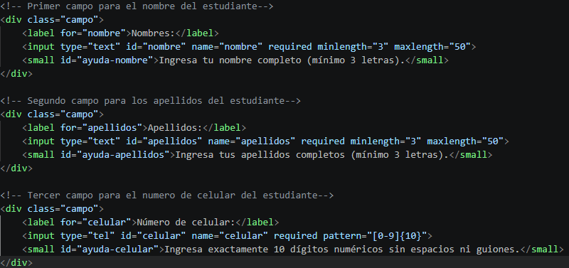
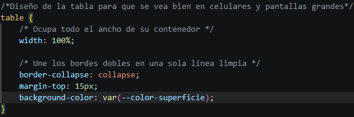
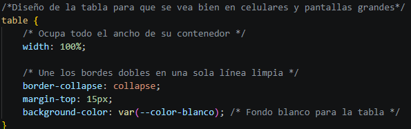
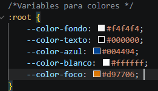
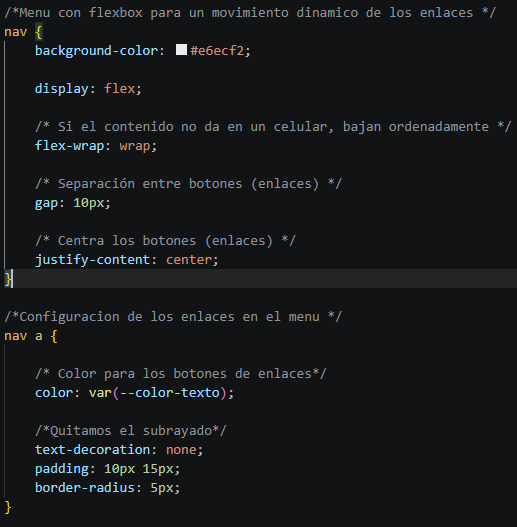

# Respuesta a informde de auditoría recibida — Parte 3: Respuesta y corrección

| N.º Hallazgo | Decisión (Acepta/Refuta) | Justificación con la norma | Evidencia antes y después | Commit |
| :---: | :--- | :--- | :--- | :--- |
| **1** | Acepta | Se acepta la observación sobre el aspecto funcional. Según la especificación **WHATWG HTML (§ 7.4.6.4 - Navigating to a fragment)**, para que la navegación por fragmento se ejecute correctamente, el valor del atributo `href` debe coincidir con el identificador (`id`) de un elemento existente en el DOM. Aunque no constituye una falta de sintaxis en el validador W3C ni un error estricto de foco WCAG, el enlace no cumplía su propósito práctico de desplazamiento interno. |  | Corrección del hallazgo 1: enlace a #horarios |
| **2** | Acepta | Se acepta la observación. El Criterio de Conformidad **WCAG 2.2 - 3.3.2 (Etiquetas o instrucciones, Nivel A)** y la técnica **H90** exigen proporcionar instrucciones visibles o indicadores de obligatoriedad antes de la interacción. Existían restricciones nativas (`required`, `minlength="3"`, `pattern="[0-9]{10}"`) sin un aviso visual ni indicación de formato para el usuario. |  = = = = = = = = = = =  | Agregar instrucciones visibles y texto de ayuda en campos obligatorios |
| **3** | Acepta | Se acepta la observación. Según **W3C CSS Custom Properties Level 1 (§ 3.1 - Invalid Variables)**, si una propiedad personalizada no está declarada en el ámbito (`:root`) ni posee un valor de reserva (*fallback*) dentro del bloque `var()`, la sustitución falla en tiempo de cómputo y el navegador aplica el valor inicial por defecto (`transparent`). |  = = = = = = = = = = =  | Agregar instrucciones visibles y texto de ayuda en campos obligatorios |
| **4** | Acepta | Se acepta la observación. Según WCAG 2.2 - Criterio 1.4.11 (Contraste no textual, Nivel AA), el indicador de foco requiere un contraste mínimo de 3:1 contra el fondo. Se cambió el fondo del <nav> a blanco (#ffffff) y los enlaces a azul (#004494), permitiendo usar un único color de foco negro (#000000, relación 21:1) en todo el sitio sin duplicar reglas CSS. |  = = = = = = = = = = =  | Unificar fondo de nav a claro y aplicar foco unico con contraste >= 3:1 |

## Búsqueda de hallazgos adicionales no detectados

Tras realizar una revisión exhaustiva e independiente de todo el proyecto (verificando la validez del HTML y CSS, la accesibilidad según la WCAG 2.2, la estructura semántica, los formularios, las tablas y la adaptabilidad *responsive*), no se identificaron inconsistencias ni errores adicionales a los reportados en el informe de la auditora.

Por tanto, no se aplican correcciones extra en este apartado.