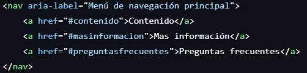
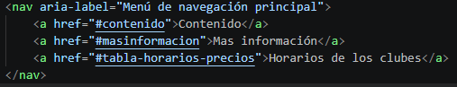

# Respuesta a informde de auditoría recibida — Parte 3: Respuesta y corrección

| N.º Hallazgo | Decisión (Acepta/Refuta) | Justificación con la norma | Evidencia antes y después | Commit |
| :---: | :--- | :--- | :--- | :--- |
| **1** | Acepto | Se acepta la observación sobre el aspecto funcional. Según la especificación **WHATWG HTML (§ 7.4.6.4 - Navigating to a fragment)**, para que la navegación por fragmento se ejecute correctamente, el valor del atributo `href` debe coincidir con el identificador (`id`) de un elemento existente en el DOM. Aunque no constituye una falta de sintaxis en el validador W3C ni un error estricto de foco WCAG, el enlace no cumplía su propósito práctico de desplazamiento interno. |  | Commit |